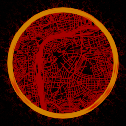

*Co-Authors:* Johanna Spieker, _traum

*Discord:* https://discord.gg/yg7yytYQRq

*Bug reports:* https://git.gay/tirisabella/sosciencity/issues (preferred, but the Discord and the mod portal discussions work too)

# Description

You are an architect. The architect of a new civilization. 

You crashlanded on this planet, lost most of your resources, found out it's inhabited by vicious aliens and - yeah - nearly died. But that is merely a small setback on the mission to found your own city. 


# Alpha Status

Sosciencity was updated to Factorio 2.1, with many systems reworked along the way, and this is its first alpha. Expect rough edges, unbalanced numbers and some placeholder graphics (Although less than in the Factorio 1.1 days). Bug reports and feedback are very welcome.

**Space Age:** Sosciencity loads together with Space Age, but it isn't balanced for it yet. Playing without Space Age is the intended way for now.


<!-- not-on-portal -->
# Screenshots


<!-- /not-on-portal -->


# Society

The society you're living in originated from a caste system and is still divided into several groups with vastly differing worldviews. 

- **The Clockwork Caste:** Undemanding, simple and living in boxes. The Clockwork Caste consists mostly of mechanics that keep factories and thus civilisations up and running.
- **The Orchid Caste:** Masters of the flora. The Caste of the farmers, gardeners, botanists. They are also really good cooks.
- **The Gunfire Caste:** The Caste of the military. They do not talk much, but they will make your defenses even deadlier.
- **The Ember Caste:** Historically the Ember Caste was a small group of people that stayed at the campfire and kept the fires alive. In modern times they became the caste of all the people without a caste-forming profession (or due to growing automation: without any profession at all). They are the core of culture, art and social engagement. Everyone likes to have them around.
- **The Foundry Caste:** If you combine the Clockwork and the Gleam Caste, you essentially get the Foundry Caste. They take scientific findings, some nights and lots of caffeine - and create a machine that solves exactly your problem.
- **The Gleam Caste:** Curious and in pursuit of a better understanding of the world - like a spark in the dark. The Gleam People dedicate their lives to expanding their knowledge and sciences. Intellectuals, professors and lifelong students that will greatly improve your research.
- **The Plasma Caste:** Medical professionals. They staff your hospitals and wards and keep the city healthy - or at least alive.

The Clockwork, Orchid and Ember Castes hatch from eggs. The others are educated in schools and faculties.


# Science

While the base game requires you to produce the equipment and funding to research, Sosciencity will add another ingredient: Ideas. 

Each tier of science packs requires you to attract another caste into your city. Its production chain makes the idea item that goes into the pack.

- Automation Science - Ember Caste: art
- Logistic Science - Orchid Caste: studies of the local ecosystem
- Military Science - Gunfire Caste: strategies
- Chemical Science - Clockwork Caste: inventions
- Production Science - Foundry Caste: scientific theories
- Utility Science - Gleam Caste: metastudies

Every invention needs to be dreamed before it can become reality, so every science pack also needs an art item from the Ember Caste.


# City

As the architect of the city you need to fulfill several responsibilities in order to keep the citizens satisfied. 

- Food
- Clean Water
- Power
- Healthcare
- Education
- Safety from Biters
- Garbage Collection


# Recommended Mods

- **[miniMAXIme](https://mods.factorio.com/mod/minime):** Sosciencity's buildings are scaled so their doors are about one tile tall - the vanilla engineer is a freaking giant next to them. If that bothers you, I recommend miniMAXIme, which shrinks him to a size that fits the city.
- **[Transport Drones](https://mods.factorio.com/mod/Transport_Drones):** Not a gameplay recommendation, just a personal one: it adds roads and little cars as a new transport system, and seeing them drive through a city makes me really happy.


# Bugs

**Please have a look at the Known Problems list before reporting.**

Sosciencity relies heavily on control scripting, which is prone to have bugs that end with desyncs and crashes. Please report any of those on the mod portal, on Git or on Discord.
If the game gives you an error message, then send that to me. If not or if you think the circumstance of the crash could be hard to replicate, then please send me your save file. 


# Known Problems

 - Entities like houses or the upbringing station that consume power show up on the "Production" side of the power statistics, despite not actually producing power. Sosciencity simulates their energy usage with hidden EEI entities, which the Factorio engine handles in a weird way. I made a feature request for that.
- You can break Sosciencity's entities by teleporting them (e.g. with Picker Dollies). For example the neighborhood connections or the hidden power consumption entities will break. Because there is no teleporting of entities in the base game, I didn't implement any teleport detection to save on everyone's UPS.
- The mod doesn't work with multiple player forces. I don't know what will happen, I never played PvP. But not caring about Forces saved myself a lot of headaches.


# On the Use of AI

I use AI tools while working on Sosciencity, for the code and for the graphics.

I taught myself Blender, and the mod had its style before AI tools became a big thing. I've tried lots of ways to make 3D objects since then, with and without AI, but I keep working on every building until it matches what I had in mind. I'm proud of the art, and AI has made this hobby a lot more fun for me. To me, slop is when nobody cares about the result - and I care about this mod a lot.

If you prefer to avoid mods made with AI assistance, this note is here so you can make an informed choice.


# Modding the Mod

Sosciencity has a modding API, but it's a work in progress - extensibility is being added piece by piece rather than designed in from the start. Right now other mods can add their own foods, drinking water, housing and buildings and have them participate in Sosciencity's systems as if they were part of the base mod.

If you want to mod Sosciencity and the seam you need isn't exposed yet, please open a feature request describing what you're trying to do.

### Definition fields

Everything Sosciencity knows about a food, house, drinking water or building is described by a plain Lua definition table. The available fields - and what each one does - are documented by the definitions of the base mod's own content in `constants/`:

- `constants/food.lua` - nutrition, taste, group, healthiness, ...
- `constants/housing.lua` - room count, comfort, caste traits, ...
- `constants/drinking-water.lua` - health and happiness effects
- `constants/buildings.lua` - type, power usage, workforce, range, ...

Read the entries there to learn which fields exist before writing your own definitions. Everything below just feeds tables of this shape into Sosciencity.

### Data stage - creating prototypes

Once Sosciencity's data stage has run, a global `Sosciencity` table is available to any mod that loads after it. Use its helpers instead of assembling prototypes by hand: they build correctly-shaped prototypes for you - handling the food-as-tool conversion, EEI registration for power usage, and the auto-generated tooltips - so your content matches how the base mod creates its own.

```lua
-- in data-stage
Sosciencity.create_food_item({
    name = "arugula",
    icon = "__your-mod__/graphics/arugula.png",
    icon_size = 64,
    subgroup = "sosciencity-food",
    stack_size = 50,
    -- ... normal ItemPrototype fields
}, food_definition)

Sosciencity.configure_building("your-manufactory", {
    type = Type.manufactory,
    power_usage = 50 * Unit.kW,
    range = 20,
    eei = true
})
```

Also available: `make_existing_item_food` (retrofit an existing item into a food item) and `create_house` (item + recipe + entity in one call).

The building example above uses `Unit` and `Type`. These are plain Lua tables you can pull in from Sosciencity so you express quantities the same way the base mod does (`Unit` converts human-readable values like kW to Factorio's per-tick units; `Type` maps building types to their internal IDs):

```lua
local Unit = require("__sosciencity__/constants/unit")
local Type = require("__sosciencity__/enums/type")
```

### Control stage - registering gameplay definitions

The data stage only builds the prototypes; the runtime still needs the definition tables. Register those through the remote interface:

```lua
remote.call("sosciencity", "register_food", "arugula", food_definition)
remote.call("sosciencity", "register_house", "your-apartment", house_definition)
remote.call("sosciencity", "register_drinking_water", "spring-water", water_definition)
remote.call("sosciencity", "register_building", "your-manufactory", building_definition)
```

Each `definition` is a table of the shape documented in the matching `constants/` file above.


# License

The code in this repository is licensed under the [MIT License](LICENSE).

The mod's art and graphics live in the separate `sosciencity-graphics` mod and are licensed under CC-BY.


# Credits

Thanks to all the nice, helpful people in the Foundry community and in the Factorio discord's mod making channel.
Huge thanks to justarandomgeek, their Factorio Debugger saved me an ocean of headaches.
